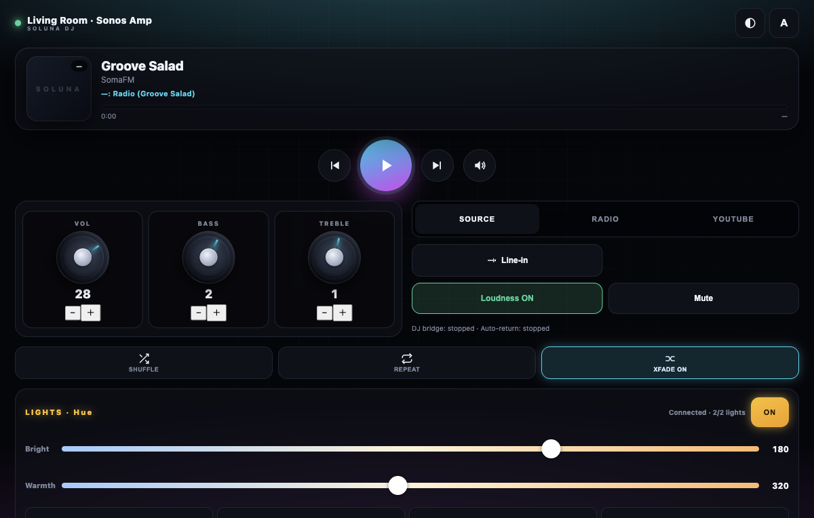
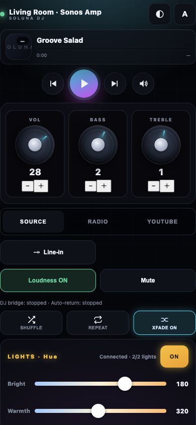

# soluna-sonos

[](https://github.com/yukihamada/soluna-sonos/actions/workflows/tests.yml)
[](LICENSE)
[](https://www.python.org/)

A one-file browser dashboard for a **Sonos** speaker. Open a page on your phone
and control playback, radio, line-in, volume, EQ, play mode, crossfade and
optional Philips Hue lights — without the Sonos app.

<p align="center">
  
</p>

<p align="center">
  
</p>

<sub>Screenshots use sample state, not a real household. The speaker name, IPs
and light IDs are placeholders.</sub>

## Why

Changing bass, treble, loudness or crossfade normally means the Sonos app, an
account and a cloud round-trip. This is a local page that talks to the speaker
directly over UPnP. No account, no build step, no
JavaScript framework — one Python file and one HTML page.

**Core needs only a Sonos and `soco`.** The 4-deck mixer console and the WORLD
source button are optional: they appear only when the matching local daemon is
running. Those daemons are separate programs and are *not* included here — the
dashboard just talks to their HTTP endpoints.

Everything site-specific (speaker IP, ports, helper daemons, Hue pairing) is
configuration, not code. With no configuration at all it discovers a Sonos on
your network over SSDP and serves a working dashboard on `127.0.0.1:8100`.

```
┌─────────────┐   HTTP    ┌──────────────┐   UPnP/SOAP   ┌────────┐
│  browser    │ ────────► │ soluna-sonos │ ────────────► │ Sonos  │
└─────────────┘           └──────┬───────┘               └────────┘
                                 │ optional
                    ┌────────────┼─────────────┐
                    ▼            ▼             ▼
              WORLD daemon   mixer daemon   Hue bridge
```

## Contents

- [Install and run](#install-and-run)
- [Features](#features)
- [Configuration](#configuration)
- [Hue](#hue)
- [Running as a service](#running-as-a-service)
- [HTTP API](#http-api)
- [Troubleshooting](#troubleshooting)
- [What this does not do](#what-this-does-not-do)
- [Security notes](#security-notes)
- [Tests](#tests)
- [License](#license)

## Install and run

Requires Python 3.9+ and a Sonos speaker on the same network.

```bash
git clone https://github.com/yukihamada/soluna-sonos.git
cd soluna-sonos
python3 -m venv .venv && . .venv/bin/activate
pip install -r requirements.txt

# local only, auto-discover the speaker
python3 soluna_web.py
```

Then open <http://127.0.0.1:8100/>.

```bash
# reachable from your phone on the LAN (prints the address to use)
python3 soluna_web.py --host 0.0.0.0

# pin the speaker instead of discovering it
python3 soluna_web.py --sonos 192.168.1.50
```

> **No authentication.** The dashboard can change your speaker's volume and
> source. Only bind to `0.0.0.0` on a network you trust.

## Features

Core (needs only a Sonos and `soco`):

- play / pause / next / previous, mute, volume with a configurable ceiling
- bass / treble / loudness
- shuffle, repeat, crossfade
- SomaFM radio presets (Groove Salad, Drone Zone, Secret Agent, Lush)
- line-in (DJ) source switching
- now-playing artwork proxied through the dashboard
- seek bar, dark/light theme and a text-size toggle, both remembered locally
- live status polling that backs off (2s, growing 1.5× to a 15s ceiling) while
  the speaker is unreachable, and pauses entirely while the tab is hidden

Optional (each one is detected; when absent the UI hides or reports it as stopped):

- **YouTube** — paste a URL, audio is extracted with `yt-dlp` + `ffmpeg` and
  served to the speaker from the dashboard. Supports HTTP Range requests, so
  seeking works.
- **Mixer** — a separate local daemon exposing `/mix/*`. The 4-deck console,
  crossfader and live waveforms appear when the daemon's `/mix/status` answers
  (works on any OS), or when its launchd label is running (macOS).
- **WORLD** — a separate local stream daemon; when its launchd label is
  configured and running, the WORLD source button appears.
- **Hue** — on/off, brightness, color temperature and presets for the lights you
  list.

## Configuration

All settings are environment variables. Three also have CLI flags: `--host`,
`--port` and `--sonos`.

| Variable | Default | Meaning |
| --- | --- | --- |
| `SOLUNA_SONOS` | *(empty → SSDP discover)* | Speaker IP address (`--sonos`) |
| `SOLUNA_HOST` | `127.0.0.1` | Bind address (`--host`) |
| `SOLUNA_WEB_PORT` | `8100` | Dashboard port (`--port`) |
| `SOLUNA_MAX_VOL` | `40` | Hard volume ceiling, so a mis-drag can't blast the room |
| `SOLUNA_BRAND` | `SOLUNA` | Name shown in the page title and labels |
| `SOLUNA_STATE_DIR` | `$XDG_RUNTIME_DIR/soluna-web` or `$TMPDIR/soluna-web` | Hold files, YouTube cache |
| `SOLUNA_WORLD_PREFIX` | `world-` | Filename prefix for the hold files (`<prefix>hold`, `<prefix>pause`, …) |
| `SOLUNA_YT_CACHE` | `$SOLUNA_STATE_DIR/yt` | Where extracted YouTube audio is cached |
| `SOLUNA_PUBLIC_HOST` | *(auto-detected LAN IP)* | Address the speaker uses to fetch streams from this host |
| `SOLUNA_YTDLP` | *(found on `PATH`)* | Path to `yt-dlp` |
| `SOLUNA_FFMPEG_DIR` | *(dir of `ffmpeg` on `PATH`)* | Passed to `yt-dlp --ffmpeg-location` |
| `SOLUNA_HUE_CONFIG` | `~/.config/soluna-web/hue.json` | Hue pairing file |
| `SOLUNA_ART_MAX_BYTES` | `3145728` (3 MiB) | Largest artwork image the proxy will pass through |

Optional helper daemons — leave empty unless you run them:

| Variable | Default | Meaning |
| --- | --- | --- |
| `SOLUNA_WORLD_PORT` | `8099` | Port of the WORLD stream daemon |
| `SOLUNA_MIX_PORT` | `8110` | Port of the mixer daemon |
| `SOLUNA_WORLD_LABEL` | *(empty)* | launchd label of the WORLD daemon, for the status readout |
| `SOLUNA_MIX_LABEL` | *(empty)* | launchd label of the mixer daemon |
| `SOLUNA_DJ_LABEL` | *(empty)* | launchd label of a MIDI/controller bridge |

The `*_LABEL` variables are only probed with `launchctl list` on macOS. On other
platforms they are ignored and the feature reports as stopped.

### Hue

1. Find the bridge IP (the Hue app shows it, or check your router).
2. Press the physical button on the bridge.
3. Within 30 seconds, create an application key:

```bash
curl -X POST http://<bridge-ip>/api \
  -H 'Content-Type: application/json' \
  -d '{"devicetype":"soluna-sonos#mac"}'
# → [{"success":{"username":"aBcDeFgHiJkLmNoP"}}]
```

4. List your light IDs, then write the config file:

```bash
curl -s http://<bridge-ip>/api/<username>/lights | python3 -m json.tool | head -20
```

```bash
mkdir -p ~/.config/soluna-web
cat > ~/.config/soluna-web/hue.json <<'JSON'
{
  "bridge": "192.168.1.20",
  "username": "aBcDeFgHiJkLmNoP",
  "lights": ["1", "2"]
}
JSON
chmod 600 ~/.config/soluna-web/hue.json
```

This file holds a credential. It is git-ignored; never commit it.

### Hold-file protocol (WORLD daemon)

If you run a separate stream daemon, it and the dashboard coordinate through
small files in `SOLUNA_STATE_DIR`:

| File | Meaning |
| --- | --- |
| `<prefix>hold` | Dashboard has taken the speaker; the daemon must not reclaim it |
| `<prefix>pause` | Ask the daemon to pause |
| `<prefix>now` | Written by the dashboard to nudge the daemon to switch to WORLD |
| `<prefix>current.json` | Structured now-playing state, read by the dashboard |

`<prefix>` is `SOLUNA_WORLD_PREFIX` (default `world-`). If your daemon already
uses flat names, point both at the same place:

```bash
SOLUNA_STATE_DIR=/tmp SOLUNA_WORLD_PREFIX=soluna-world- SOLUNA_YT_CACHE=/tmp/soluna-yt \
  python3 soluna_web.py
```

Any daemon that honours these files can be used; the dashboard only reads and
writes them.

## Running as a service

`docs/local.soluna-web.plist.example` is a launchd template. Copy it to
`~/Library/LaunchAgents/`, replace `__PYTHON__`, `__SCRIPT__` and the
environment values, then:

```bash
launchctl load ~/Library/LaunchAgents/<label>.plist
```

On Linux, the same script works under a systemd unit with `Environment=` lines
for the variables above.

## HTTP API

The page talks to a small JSON API, usable on its own.

| Endpoint | Purpose |
| --- | --- |
| `GET /api/status` | Full state: source, volume, EQ, play mode, mix, Hue, YouTube |
| `POST /api/action` | Run one command (see below) |
| `GET /api/art?u=<url>` | Artwork proxy, allow-listed hosts only |
| `GET /api/wave?deck=A&n=240` | Waveform peaks, when the mixer daemon runs |
| `GET /yt/<id>.mp3` | Cached YouTube audio, with Range support |

`POST /api/action` requires `Content-Type: application/json` and a same-origin
`Origin`/`Referer`. It returns `{"ok": true}` or `{"error": "..."}`.

```bash
curl -s http://127.0.0.1:8100/api/status | python3 -m json.tool

curl -s -X POST http://127.0.0.1:8100/api/action \
  -H 'Content-Type: application/json' \
  -H 'Origin: http://127.0.0.1:8100' \
  -d '{"cmd":"volume","value":25}'
```

Commands, by group:

| Group | `cmd` | Extra fields |
| --- | --- | --- |
| Transport | `play` `pause` `toggle` `next` `previous` `seek` | `value` (seconds) for `seek` |
| Level | `volume` `mute` `loudness` | `value`; `volume` is clamped to `SOLUNA_MAX_VOL` |
| Tone | `bass` `treble` | `value`, −10…10 |
| Mode | `playmode` `crossfade` | `mode` ∈ `NORMAL` `SHUFFLE` `SHUFFLE_NOREPEAT` `REPEAT_ALL` `REPEAT_ONE`; `value` for `crossfade` |
| Source | `radio` `linein` `world` `mix` `youtube` | `key` for `radio`; `url` for `youtube` |
| Mixer | `deck` `deckctl` `pfl` `bank` `crossfader` `mixauto` `cue` `mixmaster` | see `deck_load()` for `deck` |
| Lights | `hue` | `on` `bri` `ct` `sat` |

Omitting `value` on `mute`, `loudness` or `crossfade` toggles the current state.

## Troubleshooting

| Symptom | Cause and fix |
| --- | --- |
| Banner says "no answer from …" | The IP is wrong or the speaker is off. Run with no `SOLUNA_SONOS` to auto-discover, or pass the right `--sonos`. |
| Banner says "the speaker timed out" | The speaker is busy or the network drops UPnP. Retry; if it persists, pin the IP instead of using discovery. |
| `No Sonos found (set SOLUNA_SONOS or pass --sonos)` | SSDP is blocked (common on guest VLANs and Docker bridge networks). Set `SOLUNA_SONOS` explicitly. |
| `cannot bind … Address already in use` | Another process owns the port. Pass `--port`. |
| `soco is required` | The venv isn't active. `pip install -r requirements.txt`. |
| Page loads but every control is disabled | The speaker is unreachable; see the banner text for the reason. |
| YouTube button does nothing | `yt-dlp` or `ffmpeg` is missing from `PATH`, or `SOLUNA_YTDLP` points at nothing. |
| Phone can't reach the page | You started it without `--host 0.0.0.0`, or a firewall blocks the port. |
| Mixer console missing | Expected — it appears only when the mixer daemon answers on `SOLUNA_MIX_PORT` or its `SOLUNA_MIX_LABEL` is running. |

## What this does not do

Stated plainly so you don't clone it expecting otherwise:

- **No authentication and no TLS.** Anyone who can reach the port can control
  the speaker. It is a LAN appliance.
- **Single speaker.** It targets one zone; grouping, stereo pairs and
  multi-room sync are not exposed.
- **No music-library browsing.** It controls what is already playing, plus
  SomaFM presets, line-in and YouTube. There is no Spotify/Apple Music browse
  or search.
- **The mixer and WORLD daemons are not included.** Only the client side is here.
- **macOS-oriented service config.** The launchd template is macOS; Linux needs
  your own unit file.
- **No persistence.** Volume, EQ and mode live on the speaker; nothing else is
  stored server-side.

## Security notes

- No authentication and no TLS. Treat it as a LAN appliance, and only bind to
  `0.0.0.0` on a network you trust.
- Writes (`POST /api/action`) require `Content-Type: application/json` and a
  same-origin `Origin`/`Referer`, so a random web page cannot change your
  speaker through a plain HTML form.
- The artwork proxy matches real domain boundaries (`somafm.com`,
  `*.somafm.com` — never `evilsomafm.com`) and does **not** follow redirects:
  a 3xx from an allow-listed host is rejected, so it cannot be bounced to an
  internal address. Images above `SOLUNA_ART_MAX_BYTES` (default 3 MiB) are
  rejected rather than truncated.
- The artwork proxy only fetches allow-listed hosts (SomaFM, YouTube image
  hosts, and the configured speaker/LAN address).
- The Hue application key lives in a local file outside the repo.
- No third-party JavaScript, fonts or analytics are loaded; the page is served
  entirely from this process.

## Tests

```bash
python3 -m unittest discover -s tests -v
```

Sixteen smoke tests start the server on a free port with the speaker pointed at
`127.0.0.1` (nothing listening), so no real speaker is needed. They cover the
unreachable-speaker path and the full offline status shape (including that the
optional `mix`/`hue`/`yt` keys are still present), brand templating, `HEAD` on
`/` and `/api/status` (including that the advertised length matches `GET`), the
artwork allow-list and its lookalike-domain rejection, the `POST /api/action`
guards (non-JSON, cross-origin, same-origin, unknown command), that the page
loads no third-party resources, that the polling backoff counts a speaker
outage, and that a mixer daemon answering over HTTP alone is enough to show the
console.

CI runs the same suite on Python 3.9, 3.11 and 3.13.

## License

MIT — see [`LICENSE`](LICENSE).
